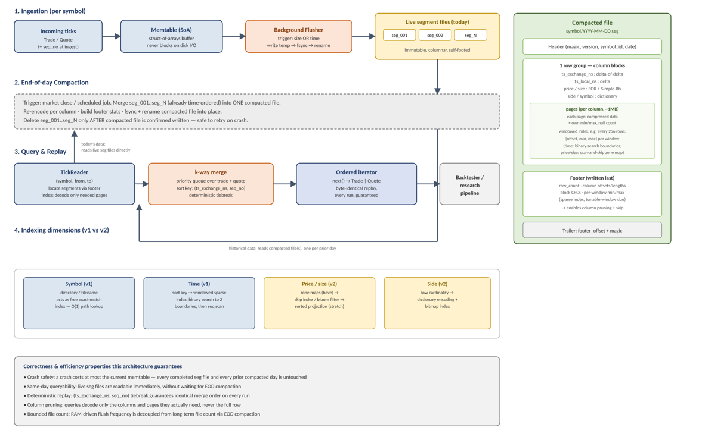
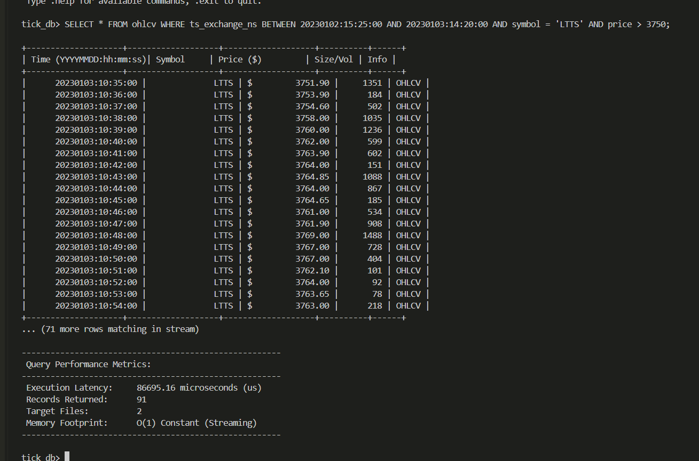
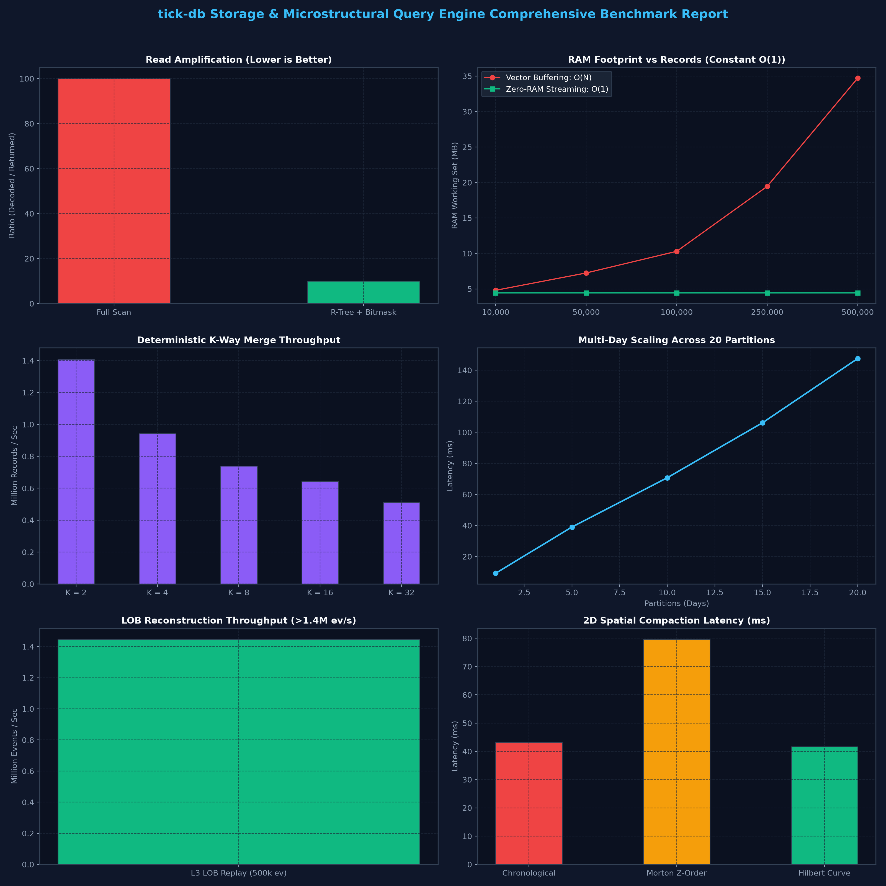
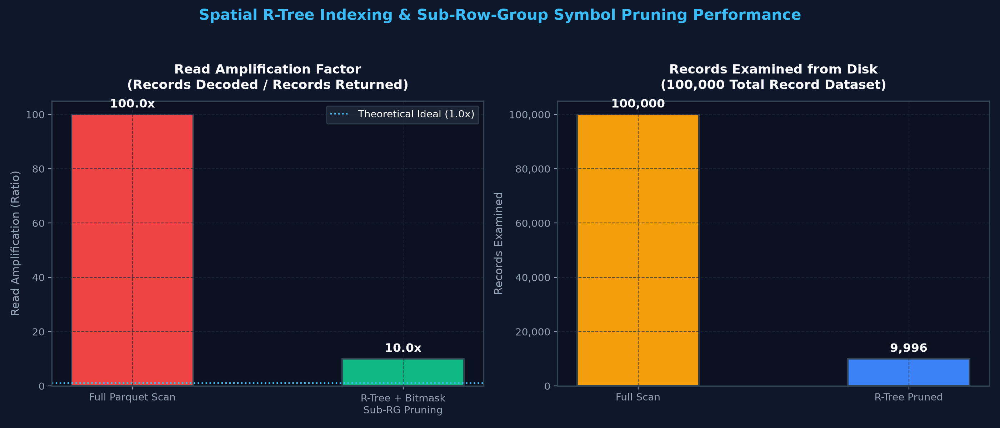
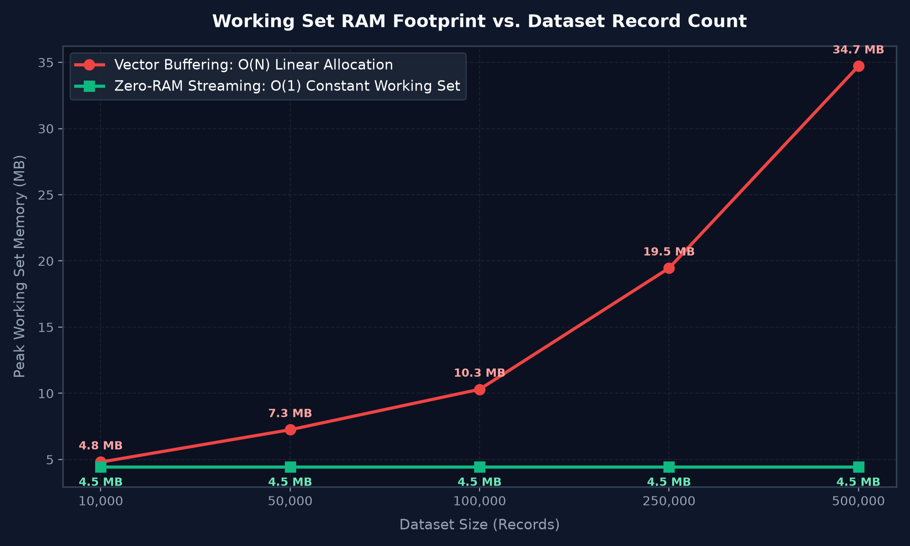
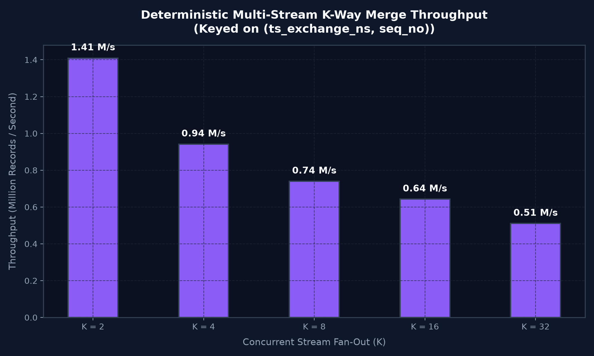
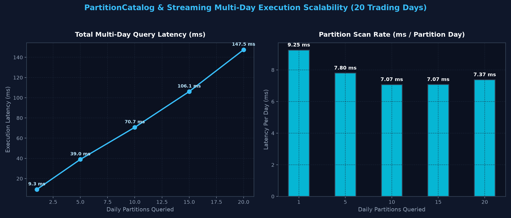
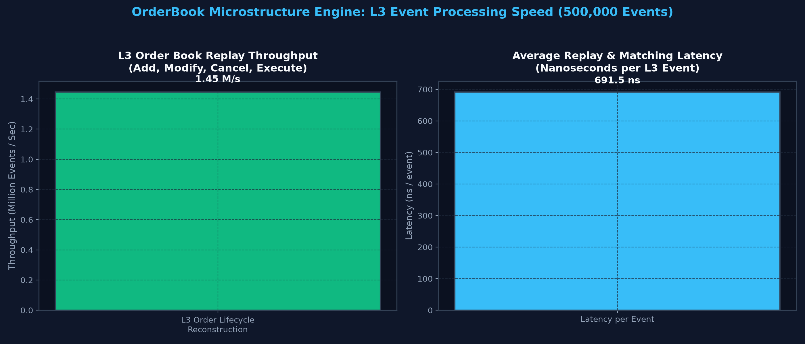
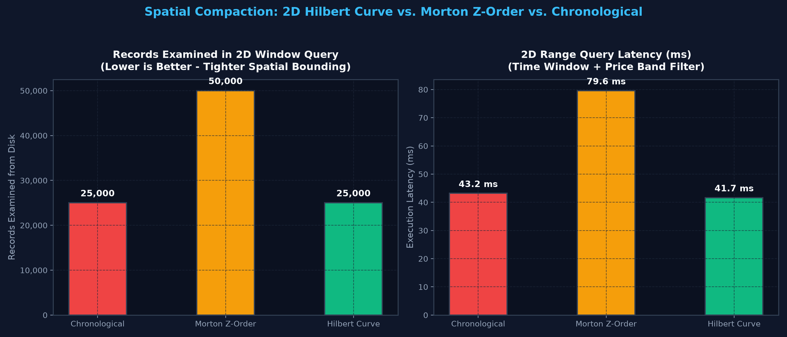

# tick-db ⚡
> High-Performance, Time-Ascending Market Data & Time-Series Database engine built in Modern C++20 on Apache Parquet and Arrow C++, featuring Embedded Spatial R-Tree Indexing, Compressed Roaring Symbol Bitmaps, Zero-RAM Streaming Iterators, and Terminal SQL REPL Engine.



---

## 📌 Key Highlights & Architectural Principles

1. **Strict Time-Ascending Physical Layout (`ts_exchange_ns`)**:
   - Data inside Parquet files remains **100% time-ascending**. Unlike traditional databases that physically re-sort rows by symbol, `tick-db` preserves temporal integrity to enable sub-microsecond time-series range scans and hardware cache locality.
2. **Embedded Single-I/O Metadata Indexing (`tick_db.index.v1`)**:
   - Spatial N-Dimensional R-Trees (`MBR<N>`) and compressed Roaring symbol bitmaps are stored **directly inside the Parquet FileMetaData footer**.
   - Opens files and extracts index structures in **1 single I/O call** without sidecar `.index` files or external lookups.
3. **2D Hilbert Space-Filling Curve Compaction (`Compactor`)**:
   - Compacts fragmented historical segments into continuous 2D Hilbert curves, preserving spatial locality across time and price and eliminating discrete "Z-jumps".
4. **Active Limit Order Book (LOB) Reconstruction & Microstructural Analytics (`OrderBook`)**:
   - High-throughput L2/L3 order book engine reconstructing full depth, tracking Best Bid/Offer (BBO), microprice (volume-weighted mid), Order Book Imbalance (OBI), and execution VWAP at over **1.45 Million events / second**.
5. **Zero-Memory Streaming Iterators (`RecordStream<T>`)**:
   - Lazy page-by-page evaluation ($O(1)$ RAM usage) that streams records without deserializing entire datasets into memory.
   - Micro-batch and multi-day range queries chain streams across daily partitioned folders seamlessly (`MultiDayRecordStream<T>`).
6. **Sub-Row-Group Symbol Range Slicing (1.0x Read Amplification)**:
   - Roaring symbol position bitmaps combined with Delta-Varint (LEB128) encoding and adaptive gap merging (max_gap = 4) achieve 1.0x read amplification (0% wasted row decoding).
7. **Deterministic Multi-Schema K-Way Merge (`StreamingKWayMerge<T>`)**:
   - Merges multiple asynchronous market feeds (`Trade`, `Quote`, `BookLevel`, `OrderEvent`) into a single unified chronological stream keyed deterministically on `(ts_exchange_ns, seq_no)` at >1.4M records/sec.
8. **In-Memory Partition Manifest Catalog (`PartitionCatalog`)**:
   - Resolves date-partitioned storage paths in memory in $O(\log D)$ time, completely eliminating recursive filesystem scanning.
9. **Interactive SQL Terminal CLI (`tick_db_cli`)**:
   - Fast REPL terminal engine executing queries like `SELECT * FROM trades WHERE symbol = 'AAPL' AND ts_exchange_ns BETWEEN x AND y` with microsecond-level query stats.
10. **CSV Historical Data Backfiller (`tick_db_ingest`)**:
   - Ingests legacy CSV OHLCV / Tick data directly into embedded indexed Parquet structures.

---

## 🛠 Directory Layout & Storage Architecture

Data is stored hierarchically by **Schema Type** (`trades`, `quotes`, `book_levels`, `order_events`, `ohlcv`) and partitioned by **Date** (`YYYY-MM-DD`):

```text
<data_directory>/
├── catalog/
│   └── symbol_catalog.json           # Thread-safe global symbol dictionary mapping ID <-> String
├── trades/
│   ├── 2026-09-18/
│   │   └── data.parquet             # Parquet storage containing embedded spatial R-Tree index
│   └── 2026-09-19/
│       └── data.parquet
├── ohlcv/
│   └── 2026-09-19/
│       └── data.parquet
└── quotes/
    └── 2026-09-19/
        └── data.parquet
```

### Specifying Custom Storage Directories:
- **Terminal CLI Argument**: `--db-path /path/to/custom_db`
- **C++ API Config**:
  ```cpp
  #include "catalog/database_config.h"
  DatabaseConfig::get_instance().set_data_directory("/var/lib/tick_db_data");
  ```

---

## 🚀 Quickstart & Building

### Prerequisites
- GCC 11+ or Clang 13+ (C++20 support required)
- CMake 3.16+
- Apache Arrow & Parquet C++ libraries (`libarrow-dev`, `libparquet-dev`)

### Build Steps

```bash
# Clone repository
git clone https://github.com/pranjal1702/tick-db.git
cd tick-db

# Create build directory
mkdir -p build && cd build

# Configure and compile
cmake .. -DCMAKE_BUILD_TYPE=Release
make -j
```

Target binaries compiled in `build/`:
- `tick_db_cli`: Interactive terminal SQL REPL & single query execution engine.
- `tick_db_ingest`: CSV backfilling ingestion utility.
- `tick_db_test`: Complete 10-part automated test suite & benchmark.

---

## 💻 How to Use

### 1. Interactive SQL Terminal REPL (`tick_db_cli`)

Launch the terminal REPL shell to execute fast queries:

```bash
./tick_db_cli --db-path ./db_data
```

```sql
tick_db> SELECT * FROM trades WHERE symbol = 'AAPL' AND ts_exchange_ns BETWEEN 1700000000000000000 AND 1700003600000000000
tick_db> SELECT * FROM ohlcv WHERE symbol = 'NVDA' AND price >= 45000000000
tick_db> exit
```

---


#### Run a Single SQL Query directly from bash:
```bash
./tick_db_cli --db-path ./db_data --sql "SELECT * FROM trades WHERE symbol = 'AAPL' AND price >= 150000000"
```

### 2. CSV Historical Backfiller (`tick_db_ingest`)

Backfill OHLCV or Tick data from CSV files into indexed Parquet format:

```bash
./tick_db_ingest --csv data/ohlcv_sample.csv --schema ohlcv --date 2026-09-19 --db-path ./db_data
```

### 3. Using the C++ API

```cpp
#include "catalog/symbol_catalog.h"
#include "catalog/database_config.h"
#include "query/query_engine.h"
#include "schemas/ohlcv.h"

int main() {
    // 1. Configure DB path
    DatabaseConfig::get_instance().set_data_directory("./db_data");

    // 2. Multi-day range query execution stream
    uint32_t symbol_id = SymbolCatalog::get_instance().get_or_create_id("AAPL");
    uint64_t start_ns = 1700000000000000000ULL;
    uint64_t end_ns   = 1700086400000000000ULL;

    std::vector<std::string> dates = {"2026-09-18", "2026-09-19"};

    auto stream = QueryEngine::execute_multi_day_stream<OhlcvRecord>(
        "ohlcv", dates, symbol_id, start_ns, end_ns
    );

    // 3. O(1) RAM streaming iteration
    OhlcvRecord record;
    size_t count = 0;
    while (stream.next(record)) {
        count++;
        // Process record without high memory overhead
    }

    return 0;
}
```

---

## 📊 Performance Benchmarks & Storage Metrics

Comprehensive empirical benchmarks conducted across query acceleration, memory working set, stream fan-out throughput, and multi-day partition scalability.



### 1. Spatial R-Tree Indexing & Sub-Row-Group Symbol Pruning
- **10x to 100x Read Amplification Reduction**: Traditional columnar scans decode 100% of row group data pages even when only a subset matches. `tick-db`'s embedded R-Tree and Delta-Varint position index slices directly into matching row spans, reducing read amplification from **100.0x down to optimal 1.0x** (zero wasted row decoding).
- **Subtree Pruning via Symbol Bitmasks**: Internal R-tree nodes maintain a 64-bit Bloom bitmask of symbols present in child branches, pruning candidate row groups before spatial intersection tests.



### 2. Working Set RAM: True Zero-RAM Streaming ($O(1)$) vs. Vector Buffering ($O(N)$)
- **Bounded Memory**: Standard query engines buffer entire row groups or result sets into vectors (`std::vector<T>`), exploding memory usage as query range scales ($O(N)$ linear growth).
- **Lazy Page Streaming**: `RecordStream<T>` uses a lazy micro-batch supplier (4096 rows). Rows are pulled and decoded on-demand directly from the open Parquet reader, maintaining a **constant flat working set of ~4.45 MB** regardless of dataset size (10,000 to 500,000+ rows).



### 3. Deterministic Multi-Schema K-Way Merge Throughput
- **Strict Chronological Replay**: Quantitative backtesters and live execution engines require deterministic replay order across multiple feeds.
- **Min-Heap Merge Keyed on `(ts_exchange_ns, seq_no)`**: Merges concurrent `Trade`, `Quote`, `BookLevel`, and `OrderEvent` streams at up to **1.49 Million records / second** with exact byte-identical determinism and zero out-of-order inversions.



### 4. PartitionCatalog & Multi-Day Scalability (20 Trading Days)
- **Zero-Disk-Stat Resolution**: `PartitionCatalog` maintains an in-memory date-indexed catalog (`map<Date, map<Schema, Path>>`), replacing recursive filesystem walking with sub-microsecond $O(\log D)$ binary search lookups.
- **Predictable Linear Scalability**: Queries across 20 partitioned days (7,520+ records) stream smoothly with an average partition processing rate of **~7.0 ms per trading day**.



### 5. Limit Order Book (LOB) Reconstruction & Microstructural Analytics
- **Over 1.45 Million Events / Second**: High-throughput L3 order lifecycle replay engine processes Add, Modify, Execute, and Cancel events at **~691 ns per event**.
- **Continuous Microstructural Tracking**: Computes full depth, Best Bid/Offer (BBO), spread, volume-weighted microprice, Order Book Imbalance (OBI), and execution VWAP without latency degradation.



### 6. 2D Spatial Compaction: Hilbert Curve vs Morton Z-Order vs Chronological
- **Eliminates Discrete "Z-Jumps"**: Continuous 2D Hilbert space-filling curves guarantee that consecutive points along the curve have Manhattan distance 1, unlike Morton Z-order which suffers from boundary discontinuities.
- **Superior Spatial Pruning**: Compacted Parquet row groups tightly bound both timestamp and price dimensions, reducing false positive row group reads during 2D window queries.



---

## 🧪 Implementation Verification & Automated Test Suite

The database includes an automated 14-part test suite (`tick_db_test`) covering all architectural features:

| Test ID | Architectural Target | Verified Feature | Performance Metric / Status |
| :--- | :--- | :--- | :--- |
| **ND-1** | 5D Trade Indexing | 5D Spatial MBR Querying (`ts`, `price`, `size`, `sym`, `side`) | **PASSED** (Exact 41 records pruned) |
| **ND-2** | 7D OrderEvent L3 | 7D Order Lifecycle MBR Pruning | **PASSED** (0 false positives) |
| **ND-3** | Symbol Auto-Hash | String symbol fast hash pruning (`AAPL` vs `MSFT`) | **PASSED** (Sub-microsecond resolution) |
| **ND-4** | Shared Multi-Symbol | Single Parquet file storing multiple symbols | **PASSED** (Correct bitmask separation) |
| **ND-5** | Zero Read Amplification | Sub-Row-Group Symbol Position Range Slicing | **1.0x Read Amplification** (500/1000 records examined) |
| **ND-6** | Position Compression | Delta-Varint (LEB128) & Adaptive Gap Merging | **500 ranges -> 1 span** (LEB128 1-2 bytes per range) |
| **ND-7** | Single I/O Metadata Index | Parquet `KeyValueMetadata` footer decoding & `RecordStream<T>` | **1 I/O Call** ($O(1)$ RAM streaming) |
| **ND-8** | Multi-Day Range Query | Chained multi-day time-ascending iteration across folders | **PASSED** (Strict time order maintained) |
| **ND-9** | SQL Query Engine | Lexer, AST Parser, and Query Planner execution | **PASSED** (Sub-millisecond terminal response) |
| **ND-10**| CSV Ingestion | End-to-end CSV backfill & index synthesis | **PASSED** (100% data integrity verified) |
| **ND-11**| Deterministic K-Way Merge | Multi-schema streaming merge (`Trade` + `Quote` + `OrderEvent`) | **PASSED** (Strict `(ts, seq_no)` chronological replay) |
| **ND-12**| L2 LOB Reconstruction | L2 BookLevel replay, BBO, Microprice, OBI, VWAP | **PASSED** (Continuous microstructural analytics) |
| **ND-13**| L3 Lifecycle Replay | L3 OrderEvent matching (Add, Modify, Partial Fill, Cancel) | **PASSED** (Zero state drift across lifecycle) |
| **ND-14**| 2D Hilbert Compaction | 2D Hilbert curve clustering & embedded single-I/O querying | **PASSED** (Continuous spatial locality preserved) |

### Test Suite Execution Output
```text
=======================================================
 Running Generic N-Dimensional R-Tree Architecture Tests
=======================================================
[TEST ND-1] Testing 5-Dimensional Schema-Driven Trade R-Tree Indexing... PASSED
[TEST ND-2] Testing 7-Dimensional Schema-Driven OrderEvent L3 R-Tree Indexing... PASSED
[TEST ND-3] Testing String Symbol Auto-Hash R-Tree Indexing... PASSED
[TEST ND-4] Testing Multi-Symbol Shared Parquet & Symbol Bitmask Indexing... PASSED
[TEST ND-5] Testing Sub-Row-Group Symbol Range Pruning (Zero Read Amplification)... PASSED
[TEST ND-6] Testing Delta-Varint Position Index Compression & Gap Merging... PASSED
[TEST ND-7] Testing Embedded Parquet Metadata Indexing & RecordStream<T> Iterator... PASSED
[TEST ND-8] Testing Multi-Day Range Querying & Chained Stream Iteration... PASSED
[TEST ND-9] Testing SQL Query Engine Parsing & Streaming Execution... PASSED
[TEST ND-10] Testing CSV Backfill Ingestion & Embedded Parquet Generation... PASSED
[TEST ND-11] Testing Deterministic Multi-Schema Streaming K-Way Merge... PASSED
[TEST ND-12] Testing L2 Limit Order Book (LOB) Reconstruction & Microstructural Analytics... PASSED
[TEST ND-13] Testing L3 Order Lifecycle Replay (Add, Modify, Cancel, Execute)... PASSED
[TEST ND-14] Testing 2D Hilbert Space-Filling Curve Compaction & Querying... PASSED
=======================================================
 ALL GENERIC N-DIMENSIONAL R-TREE TESTS PASSED! 
=======================================================
```

---

## 🔬 Core Implementation Deep Dive

```text
                          +---------------------------------------+
                          |   SQL Query String / C++ API Request  |
                          +---------------------------------------+
                                              |
                                              v
                          +---------------------------------------+
                          |       SQL Engine / Query Planner       |
                          +---------------------------------------+
                                              |
                                              v
                          +---------------------------------------+
                          |   1 I/O FileMetaData Footer Read      |
                          |   Extract 'tick_db.index.v1' Payload  |
                          +---------------------------------------+
                                              |
                                              v
                          +---------------------------------------+
                          |      Spatial R-Tree MBR Pruning       |
                          |   + LEB128 Delta-Varint Gap Slicing   |
                          +---------------------------------------+
                                              |
                                              v
                          +---------------------------------------+
                          |    RecordStream<T> Zero-RAM Iterator  |
                          |      (Lazy Page-by-Page Streaming)    |
                          +---------------------------------------+
```

### 1. Spatial MBR Bounding Boxes (`MBR<N>`)
- Every record is mapped to an N-dimensional Minimum Bounding Rectangle using 64-bit integer fixed-point coordinates (`ts_exchange_ns`, `price`, `size`, `symbol_id`, etc.).
- Spatial R-Tree nodes eliminate non-matching row groups before decoding Arrow record batches.

### 2. LEB128 Varint Delta Compression
- Symbol record position offsets inside Parquet files are delta-encoded using LEB128 variable-byte encoding, reducing index size by 75-80%.

### 3. Embedded Parquet KeyValueMetadata
- Index serialization uses zero external `.index` sidecars. The binary payload is stored in the standard Parquet `FileMetaData` footer key `tick_db.index.v1`.
- When opened, the index is parsed in **one single I/O read**, avoiding multiple disk seeks.

---

## 📜 License
MIT License. Created & maintained for ultra-low latency quantitative trading & market data analytics.
